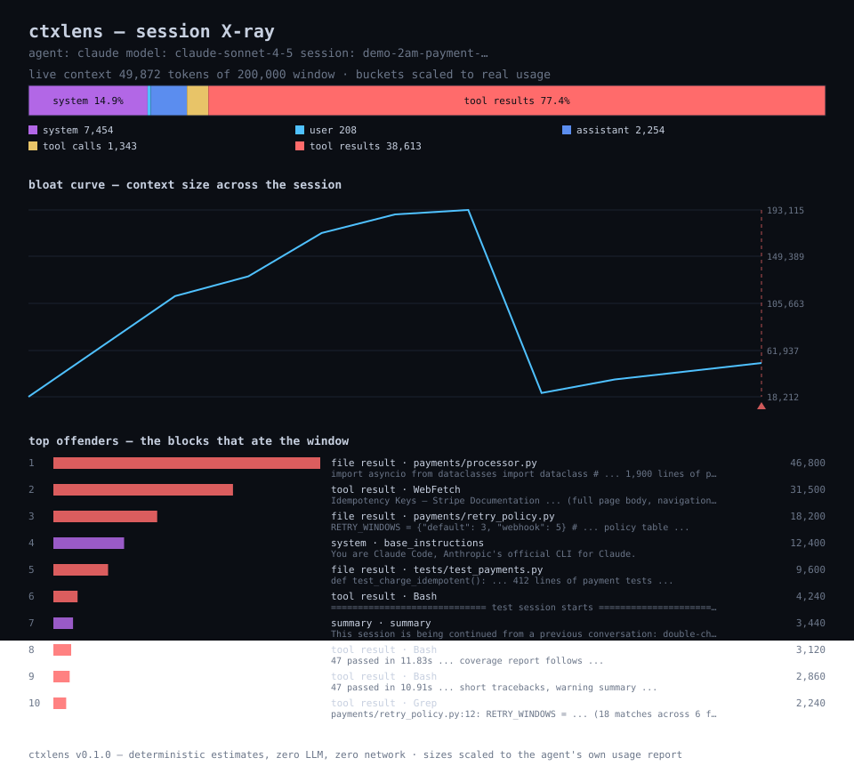

# ctxlens

**X-ray for your coding agent's context window.**

English | [简体中文](README.zh-CN.md)

> What ate your tokens? Deterministic answers · zero LLM · zero network · zero dependencies

[](https://github.com/zhengqiuyang/ctxlens/actions/workflows/ci.yml)
[](LICENSE)


---

## The cliff you never saw

It's 2 AM. Your agent has been hunting a double-charge bug for an hour and a
half, and it's been doing *beautiful* work — until it isn't.

It re-reads a file it read at minute nine. It asks you a question you already
answered. Then it apologizes, with that flat machine apology, and says the
conversation was *compacted*.

You know what happened. The context window filled up. Somewhere in there —
one `Read` that pulled a 1,900-line file, one `WebFetch` that swallowed a
documentation page whole — the window crossed its line, and the agent quietly
amputated its own memory to keep going.

What actually got dropped? *Nobody shows you that.*

Usage dashboards show you the **bill**. Your agent shows you a percentage.
Neither shows you the **anatomy**: which block ate 46k tokens, what the
compaction took away, where the curve went vertical.

ctxlens is the X-ray. It reads the session logs already on your disk and
answers three questions, deterministically, without a single LLM call:

1. **What's in my window right now** — system prompt, history, tool calls,
   tool results, by share.
2. **What were the biggest blocks** — the top offenders, ranked, with previews.
3. **What did compaction take** — before/after, net loss, the largest casualties.

---

## See it in action

```bash
ctxlens scan --demo          # built-in fictional session, nothing real touched
```

```text
ctxlens — session X-ray
agent: claude   model: claude-sonnet-4-5   session: demo-2am-payment-hunt
source: demo session (fictional)

context window  ██████████░░░░░░░░░░░░░░░░░░░░░░░░░░░░░░  24.9%  (49,872 / 200,000)

composition (live context)
  buckets scaled to the agent's own usage report
  system        ██████··································   14.9%        7,454
  user          ········································    0.4%           208
  assistant     ██······································    4.5%         2,254
  tool calls    █·······································    2.7%         1,343
  tool results  ███████████████████████████████·········   77.4%       38,613
  total                                                   100.0%       49,872

top offenders (largest blocks, top 10)
   1.   46,800  file result  payments/processor.py
        └ import asyncio from dataclasses import dataclass # …1,900 lines…
   2.   31,500  tool result  WebFetch
        └ Idempotency Keys — Stripe Documentation …(full page body)…
   3.   18,200  file result  payments/retry_policy.py
        └ RETRY_WINDOWS = {"default": 3, "webhook": 5} …

bloat curve (context size across the session)
  ▁▃▄▅▇▇█▁▁▁▃▄  real usage
  min 18,212   max 193,115   11 points

compaction forensics
  cut #20 [compact]  before 119,272  after 4,922  net loss 117,790
    ✝   46,800  file result  payments/processor.py
    ✝   31,500  tool result  WebFetch
    ✝   18,200  file result  payments/retry_policy.py
```

The same session as a shareable chart:



## Quick start

```bash
uv tool install git+https://github.com/zhengqiuyang/ctxlens
# or: pip install git+https://github.com/zhengqiuyang/ctxlens
```

```bash
ctxlens scan --demo        # look at the fictional session first
ctxlens                    # X-ray your latest session, any agent
ctxlens sessions           # what logs exist on this machine
```

Every subcommand in one table:

| Command | What it does |
|---|---|
| `ctxlens` | X-ray the most recent session found on this machine |
| `ctxlens scan [path]` | X-ray one session file (`-` = stdin, `--demo` = built-in fiction) |
| `ctxlens sessions` | list discovered session logs, newest first |
| `ctxlens --version` | print the version |

Useful `scan` flags:

| Flag | Effect |
|---|---|
| `--agent claude\|codex\|generic\|auto` | pick the parser (default: auto-detect) |
| `--format terminal\|svg\|json` | output format |
| `--out FILE` | write the report to a file instead of stdout |
| `--top N` | how many offenders to show (default 10) |
| `--max-tokens N` | exit 3 when the live context exceeds N — the CI gate |
| `--no-color` | strip ANSI even on a TTY |

## What it sees

**Composition.** The live context — what survives the most recent compaction —
broken into six buckets: system, user, assistant, tool calls, tool results,
other. When the agent logged its own usage numbers, ctxlens scales the bucket
shape to match that real total and says so (`scaled to the agent's own usage
report`).

**Top offenders.** The largest blocks in the session, ranked by estimated
size: a 46,800-token file read, a 31,500-token web page, the test-suite
output that kept growing. Each with a one-line preview.

**Compaction forensics.** Every cut gets a before/after balance: context size
on each side, the net loss, and the five biggest blocks that went in before
and didn't come out (✝).

**Bloat curve.** Context size across the whole session — real usage points
when the agent logs them, deterministic estimates otherwise. Compaction cuts
drawn as cliffs. The shape tells the story at a glance.

## The gate

Reports are nice. Gates get merged. `--max-tokens` turns ctxlens into a
two-second CI check:

```bash
ctxlens scan "$SESSION_FILE" --max-tokens 150000
echo $?   # 0 under budget · 3 over budget
```

Exit codes — the whole contract:

| Code | Meaning |
|---|---|
| `0` | success, including a scan that found nothing alarming |
| `1` | nothing to scan (no session found, unreadable path, unknown agent) |
| `2` | usage error (argparse's own) |
| `3` | budget breach — live context exceeded `--max-tokens` |

## How it works

```text
session .jsonl ──▶ adapter ──▶ blocks ──▶ analyzer ──▶ report ──▶ renderer
   (dialect)      (tolerant)   (typed)    (pure fns)             (ansi/svg/json)
```

| Module | Role |
|---|---|
| `discover` | finds session logs under `~/.claude` and `~/.codex` — file metadata only |
| `adapters` | dialect-specific parsers that map raw lines into typed `Block`s; bad lines are counted and skipped, never fatal |
| `tokens` | the deterministic estimator: ASCII ≈ 4 chars/token, CJK ≈ 1 char/token |
| `analyze` | composition, offenders, curve, compaction forensics — pure functions over the parsed session |
| `render` | terminal ANSI, byte-identical SVG, JSON |
| `cli` | subcommands, formats, the exit-code gate |

Two details worth knowing:

- **Live context, not archaeology.** After a compaction, the composition
  describes what the *window* holds now; everything before the cut stays in
  the report only as forensics.
- **Real numbers win when they exist.** If the agent logged prompt sizes,
  bucket estimates are scaled so the total matches that real measurement —
  and the report says so.

## Honesty section

ctxlens never calls an LLM, never touches the network, and never pretends to
be a tokenizer.

- **Per-block sizes are estimates.** A documented heuristic (ASCII ≈ 4
  chars/token, CJK ≈ 1 char/token), typically within ~25% of real tokenizers.
  The *ranking* — which block is biggest — is robust; the exact number is a
  lantern, not a micrometer.
- **When real numbers exist, they win.** Agents that log usage (Claude Code
  does; Codex on some builds) feed ctxlens the actual prompt size, and bucket
  estimates get scaled to it — flagged in the output.
- **Same input, same output, forever.** No timestamps, no randomness, no
  locale. Reports are diffable; SVG renders are byte-identical.

## Design principles

1. **Zero LLM in the analysis path.** The session file is the only input.
2. **Zero dependencies.** Pure standard library, Python 3.9+. `pytest` (dev)
   and `ruff` (dev) are the only extras.
3. **Local-first.** Nothing leaves your machine because nothing is ever sent anywhere.
4. **Tolerant adapters.** Agent log formats drift every release; unknown lines
   are counted and skipped, never fatal.
5. **Determinism is a feature.** A report that shifts between runs cannot be
   baselined, diffed, or gated.

## Adapters

| Agent | Location | Status |
|---|---|---|
| Claude Code | `~/.claude/projects/**/*.jsonl` | ✅ incl. real usage + compaction detection |
| Codex CLI | `~/.codex/sessions/**/*.jsonl` | ✅ incl. `context_window` from session meta |
| Generic JSONL | any file, best-effort | ✅ role/type heuristics |

A wrong or missing adapter never crashes: ctxlens warns, counts what it
could not read, and renders what it could. To add a dialect, read
[CONTRIBUTING.md](CONTRIBUTING.md) — fixture, test, table row.

## Configuration

| Setting | Effect |
|---|---|
| `CTXLENS_HOME` | redirect discovery root (tests, portable installs) |
| `NO_COLOR` | disable ANSI coloring even on a TTY |

## How this is different

| | shows composition | ranks offenders | compaction forensics | local-only |
|---|---|---|---|---|
| agent's built-in `/context` | snapshot only | — | — | ✅ |
| usage / quota monitors | — (money & counts) | — | — | varies |
| **ctxlens** | ✅ | ✅ | ✅ | ✅ |

- **vs. your agent's `/context`** — that's a single in-session snapshot. ctxlens
  works across sessions, ranks the offenders, and does compaction forensics.
- **vs. usage monitors** — they track money and quota. ctxlens tracks
  *anatomy*: what the window is made of and where it went.
- **vs. sending logs to a cloud** — ctxlens would rather stay home. It's
  local-first because the question "what did my agent read" deserves a local
  answer.

## FAQ

**Are the token numbers exact?**
No — and the README says so twice. They are deterministic estimates, usually
within ~25%, and the *ranking* is what ctxlens is built for. Where the agent
logged real usage, ctxlens uses it.

**Does it call any API?**
Never. No LLM, no network, no telemetry. The session file is the only input.

**Will it work on Windows?**
Yes — first-class. CI runs the full matrix on Windows, macOS and Linux.

**My tool isn't listed.**
Point `ctxlens scan` at its `.jsonl` anyway — the generic adapter maps common
shapes. If the result looks wrong, open an issue with one scrubbed sample
line; that's usually all an adapter needs.

**Is my code sent anywhere?**
No. Nothing leaves the machine because nothing is ever sent anywhere.

## Requirements

- Python **3.9+** — Windows, macOS, Linux
- No runtime dependencies (dev extras: `pytest`, `ruff`)
- Read access to your agent's session logs — that's all

## Roadmap

- [ ] OpenCode adapter
- [ ] `ctxlens watch` — live window gauge during a session
- [ ] Cross-session drift report (same repo, week over week)
- [ ] Flamegraph view of nested tool results

## Contributing

Small and sharp beats big and vague. The three laws (zero LLM, zero deps,
tolerant parsing) and the house style live in
[CONTRIBUTING.md](CONTRIBUTING.md). Dev setup:

```bash
pip install -e ".[dev]"
pytest
ruff check .
```

## License

[MIT](LICENSE)
