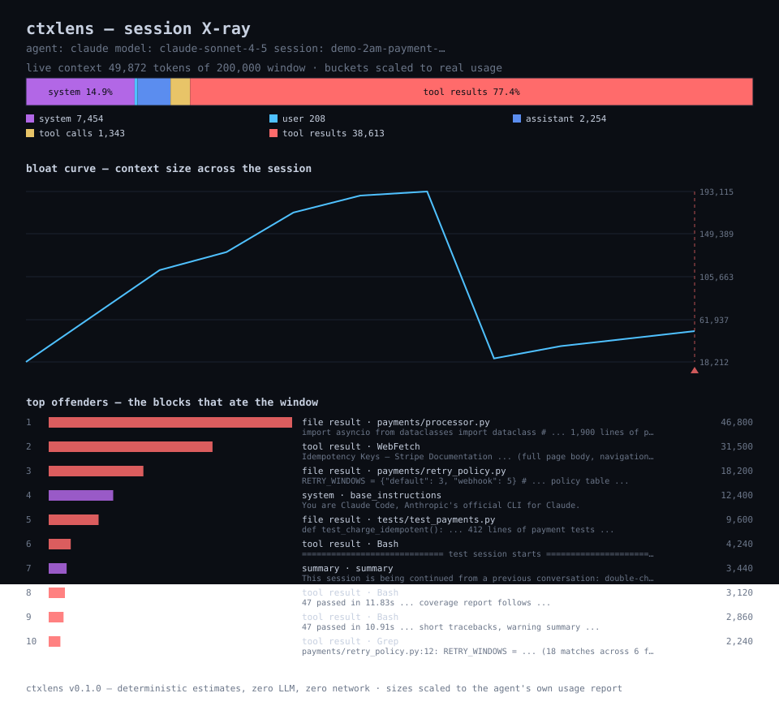

# ctxlens

**给你的编码 agent 上下文窗口拍一张 X 光片。**

[English](README.md) | 简体中文

> 上下文窗口到底被什么吃了？确定性回答 · 零 LLM · 零网络 · 零依赖

[](https://github.com/zhengqiuyang/ctxlens/actions/workflows/ci.yml)
[](LICENSE)


---

## 你从没看见过的那道悬崖

凌晨两点。你的 agent 已经追了九十分钟双扣费 bug，干得漂亮极了——直到它突然不漂亮了。

它把第九分钟读过的文件又读了一遍。它问了你早就回答过的问题。然后它道歉，用那种平直的机器道歉，说对话被 *压缩*（compacted）了。

你知道发生了什么：上下文窗口满了。某个环节——一次 `Read` 拉回 1900 行文件、一次 `WebFetch` 整页吞下文档——窗口越过了红线，agent 为了继续干活，悄悄截断了自己的记忆。

到底丢了什么？*没有工具给你看这个。*

用量面板只给你看**账单**，agent 只给你看一个百分比。没人给你看**解剖结构**：哪一块吃了 46k token、compaction 带走了什么、曲线是在哪里竖起来的。

ctxlens 就是那张 X 光片。它读取你磁盘上现成的会话日志，确定性回答三个问题——全程零 LLM 调用：

1. **窗口里现在装着什么** —— system 提示、历史、工具调用、工具结果，各占几成。
2. **最大的块是哪些** —— 元凶排行榜，带预览。
3. **compaction 带走了什么** —— 前后对比、净损失、最大的牺牲者。

---

## 实际看一眼

```bash
ctxlens scan --demo          # 内置虚构会话，不碰任何真实日志
```

```text
ctxlens — session X-ray
agent: claude   model: claude-sonnet-4-5   session: demo-2am-payment-hunt
source: demo session (fictional)

context window  ██████████░░░░░░░░░░░░░░░░░░░░░░░░░░░░░░  24.9%  (49,872 / 200,000)

composition (live context)
  buckets scaled to the agent's own usage report
  system        ██████··································   14.9%        7,454
  user          ········································    0.4%           208
  assistant     ██······································    4.5%         2,254
  tool calls    █·······································    2.7%         1,343
  tool results  ███████████████████████████████·········   77.4%       38,613
  total                                                   100.0%       49,872

top offenders (largest blocks, top 10)
   1.   46,800  file result  payments/processor.py
        └ import asyncio from dataclasses import dataclass # …1,900 lines…
   2.   31,500  tool result  WebFetch
        └ Idempotency Keys — Stripe Documentation …(full page body)…
   3.   18,200  file result  payments/retry_policy.py
        └ RETRY_WINDOWS = {"default": 3, "webhook": 5} …

bloat curve (context size across the session)
  ▁▃▄▅▇▇█▁▁▁▃▄  real usage
  min 18,212   max 193,115   11 points

compaction forensics
  cut #20 [compact]  before 119,272  after 4,922  net loss 117,790
    ✝   46,800  file result  payments/processor.py
    ✝   31,500  tool result  WebFetch
    ✝   18,200  file result  payments/retry_policy.py
```

同一场会话的可分享图表版：



## 快速开始

```bash
uv tool install git+https://github.com/zhengqiuyang/ctxlens
# 或者: pip install git+https://github.com/zhengqiuyang/ctxlens
```

```bash
ctxlens scan --demo        # 先看内置的虚构会话
ctxlens                    # 给你最近一次会话拍片，自动识别 agent
ctxlens sessions           # 本机有哪些会话日志
```

所有子命令一览：

| 命令 | 作用 |
|---|---|
| `ctxlens` | 给本机最近一次会话拍片 |
| `ctxlens scan [path]` | 给指定会话文件拍片（`-` = stdin，`--demo` = 内置虚构会话） |
| `ctxlens sessions` | 列出发现的会话日志，最新优先 |
| `ctxlens --version` | 打印版本 |

`scan` 的常用参数：

| 参数 | 效果 |
|---|---|
| `--agent claude\|codex\|generic\|auto` | 指定解析器（默认自动识别） |
| `--format terminal\|svg\|json` | 输出格式 |
| `--out FILE` | 报告写入文件而不是 stdout |
| `--top N` | 元凶排行显示多少条（默认 10） |
| `--max-tokens N` | 活上下文超过 N 时退出码 3 —— CI 闸门 |
| `--no-color` | 即使在终端上也关闭 ANSI 颜色 |

## 它看见什么

**成分拆解。** 活上下文——最近一次 compaction 之后还活着的部分——拆成六个桶：system、user、assistant、tool calls、tool results、other。当 agent 自己记了用量数字，ctxlens 会把各桶按真实总量缩放，并明确标注（`scaled to the agent's own usage report`）。

**元凶排行。** 会话里最大的块，按估算大小排序：一次 46,800 token 的文件读取、一整页 31,500 token 的网页、越长越大的测试输出。每条带一行预览。

**Compaction 取证。** 每一刀都有前后账：两侧的上下文大小、净损失、进去后再没出来的五个最大的块（✝）。

**膨胀曲线。** 整场会话的上下文尺寸——agent 记了用量就用真实值，否则用确定性估算。compaction 的刀口画成悬崖。形状一眼讲完故事。

## 闸门

报告很好看，闸门才会被合并。`--max-tokens` 把 ctxlens 变成两秒钟的 CI 检查：

```bash
ctxlens scan "$SESSION_FILE" --max-tokens 150000
echo $?   # 0 预算内 · 3 超预算
```

退出码——完整契约：

| 退出码 | 含义 |
|---|---|
| `0` | 成功，包括扫描后没发现任何告警 |
| `1` | 无可扫描（找不到会话、路径不可读、未知 agent） |
| `2` | 用法错误（argparse 自带） |
| `3` | 预算超限——活上下文超过 `--max-tokens` |

## 工作原理

```text
会话 .jsonl ──▶ 适配器 ──▶ 块流 ──▶ 分析器 ──▶ 报告 ──▶ 渲染器
  (方言)       (容错)     (类型化)   (纯函数)            (ansi/svg/json)
```

| 模块 | 职责 |
|---|---|
| `discover` | 在 `~/.claude` 和 `~/.codex` 下找会话日志——只读文件元数据 |
| `adapters` | 方言专属解析器，把原始行映射成类型化 `Block`；坏行计数跳过，绝不致命 |
| `tokens` | 确定性估计器：ASCII ≈ 4 字符/token，CJK ≈ 1 字符/token |
| `analyze` | 成分、元凶、曲线、compaction 取证——解析结果之上的纯函数 |
| `render` | 终端 ANSI、逐字节一致的 SVG、JSON |
| `cli` | 子命令、格式、退出码闸门 |

两个值得知道的细节：

- **活上下文，不是考古现场。** compaction 之后，成分描述的是*窗口*现在装着什么；刀口之前的一切只以取证形式留在报告里。
- **有真实数字时，真实数字赢。** 如果 agent 记了提示尺寸，各桶估算会缩放到真实总量对齐——并且报告里会说明。

## 诚实声明

ctxlens 从不调用 LLM、从不联网、从不假装自己是分词器。

- **逐块大小是估算值。** 一个写进文档的启发式（ASCII ≈ 4 字符/token，CJK ≈ 1 字符/token），与真实分词器偏差通常在 25% 以内。*排序*——谁最大——是稳健的；具体数字是灯笼，不是千分尺。
- **有真实数字时，真实数字优先。** 会记录用量的 agent（Claude Code 会；Codex 部分版本会）会把真实提示尺寸喂给 ctxlens，各桶按它缩放，并在输出中标注。
- **同样的输入，永远同样的输出。** 无时间戳、无随机数、无本地化。报告可 diff，SVG 逐字节一致。

## 设计原则

1. **分析路径零 LLM。** 会话文件是唯一输入。
2. **零依赖。** 纯标准库，Python 3.9+。`pytest`（dev）和 `ruff`（dev）是仅有的额外依赖。
3. **本地优先。** 什么都不发出去，因为什么都不需要发出去。
4. **容错适配器。** agent 日志格式每个版本都在漂移；看不懂的行记数跳过，绝不崩溃。
5. **确定性是特性。** 两次运行结果不一样的报告，没法基线、没法 diff、没法设闸。

## 适配器

| Agent | 位置 | 状态 |
|---|---|---|
| Claude Code | `~/.claude/projects/**/*.jsonl` | ✅ 含真实用量 + compaction 检测 |
| Codex CLI | `~/.codex/sessions/**/*.jsonl` | ✅ 含 session meta 的 `context_window` |
| 通用 JSONL | 任意文件，尽力而为 | ✅ role/type 启发式 |

适配器缺失或不对也绝不崩溃：ctxlens 告警、记数、把手头能读的渲染出来。想加一个新方言？读 [CONTRIBUTING.md](CONTRIBUTING.md)——一个 fixture、一个测试、表格加一行。

## 配置

| 设置 | 效果 |
|---|---|
| `CTXLENS_HOME` | 重定向发现根目录（测试、便携安装） |
| `NO_COLOR` | 即使在终端上也关闭 ANSI 颜色 |

## 有什么不一样

|  | 成分拆解 | 元凶排行 | compaction 取证 | 纯本地 |
|---|---|---|---|---|
| agent 内置 `/context` | 仅瞬时快照 | — | — | ✅ |
| 用量/额度监控 | —（管钱管量） | — | — | 不一定 |
| **ctxlens** | ✅ | ✅ | ✅ | ✅ |

- **对比 agent 内置的 `/context`** —— 那是单会话瞬时快照。ctxlens 跨会话、排元凶、做 compaction 取证。
- **对比用量监控** —— 它们管钱管额度，ctxlens 管**解剖结构**：窗口由什么构成、去哪儿了。
- **对比把日志传上云** —— ctxlens 更愿意待在家里。"我的 agent 读了什么"这个问题，值得一个本地的答案。

## FAQ

**token 数字精确吗？**
不精确——README 说了两遍。它们是确定性估算，偏差通常在 25% 以内，而 ctxlens 是为*排序*造的。agent 记了真实用量的地方，ctxlens 直接用真实值。

**会调用任何 API 吗？**
永远不会。无 LLM、无网络、无遥测。会话文件是唯一输入。

**Windows 上能用吗？**
能——一等公民。CI 在 Windows、macOS、Linux 上跑全矩阵。

**我的工具不在列表里。**
照样把它的 `.jsonl` 喂给 `ctxlens scan`——通用适配器会按常见形状映射。如果结果不对，开个 issue 附一行脱敏样本；通常这就够写一个适配器了。

**我的代码会被发到别处吗？**
不会。什么都不发出去，因为什么都不需要发出去。

## 环境要求

- Python **3.9+** —— Windows、macOS、Linux
- 运行时零依赖（dev 附加：`pytest`、`ruff`）
- 能读你 agent 的会话日志——仅此而已

## 路线图

- [ ] OpenCode 适配器
- [ ] `ctxlens watch` —— 会话进行时的实时窗口表
- [ ] 跨会话漂移报告（同一仓库，周对周）
- [ ] 嵌套工具结果的火焰图视图

## 参与贡献

小而锋利胜过大而含糊。三定律（零 LLM、零依赖、容错解析）与代码风格见
[CONTRIBUTING.md](CONTRIBUTING.md)。开发环境：

```bash
pip install -e ".[dev]"
pytest
ruff check .
```

## 许可

[MIT](LICENSE)
